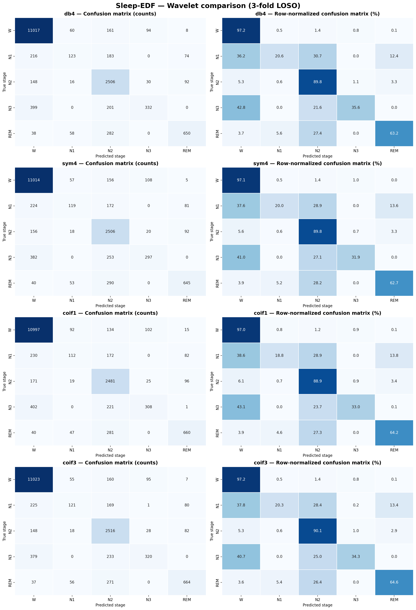
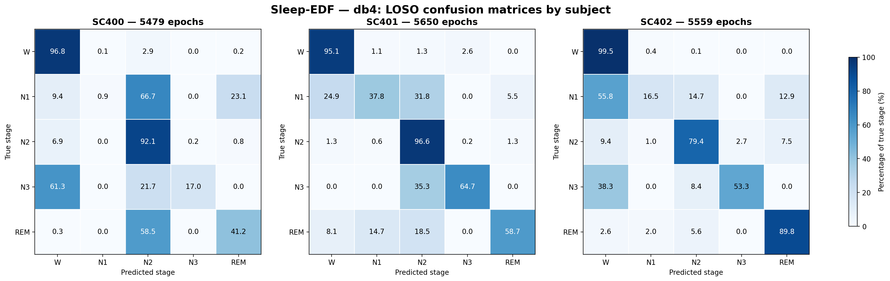
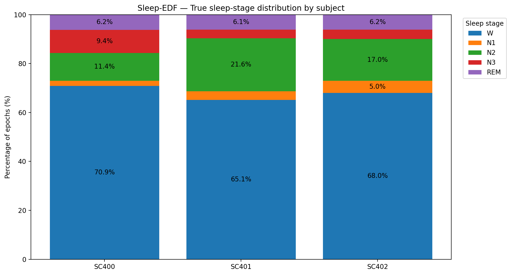

# Results log — `Sleep EDF`, `Group 14`

For a guide to the saved files and comparisons, see [the results index](results/README.md). For your first experiment, see [getting started](docs/GETTING_STARTED.md). Script paths below reflect the current folder structure, including the shared baseline runner in `scripts/internal/`; historical metrics and result directories are retained.

> It exists because Chapter 16 §16.3 defines an iteration as *done* only when it 
>
> (1) runs end to end to a result
>
> (2) reports the primary metric **with its spread**
>
> (3) is committed with a note saying what changed and why
>
> (4) is at least as good as the previous iteration **or** says in writing why the change was kept anyway. 
>
> This table is where (2), (3) and (4) land; `git log` is where (1) becomes checkable. It also makes writing the report an assembly job rather than an archaeology project.
>
> **This file is graded.** `CAPSTONE_REPORT_RUBRIC.md` **Criterion 9 — Iteration & revision history (3 pts)** takes `RESULTS.md` as its evidence, and it asks for one specific thing that a forward-only log cannot show: **at least one earlier decision you went back and changed because of a downstream result**, with the symptom that sent you back named. A row that *lowered* the headline metric and was kept for a stated reason is full-marks evidence, not a weakness. Rows here are also direct evidence for "Reproducibility & engineering" and "Report quality & defence".

**Track:** `sleep_edf` ·
**Split unit:** `subject` · **Primary metric:** Cohen's kappa ·
**Evaluation mode:** new-subject (LOSO; five synthetic subjects / three real subjects)

## Iteration log

Paste the metric straight from the harness — `rep["summary"]` prints the required shape, e.g.
`mean cohens_kappa 0.61 (sd 0.12, range 0.34-0.73 across 8 subjects)`. A pooled number with no
spread is half a result.

| # | Date | What changed & why (one line) | Primary metric **with spread** | Better than previous? | If not — why it was kept | Commit |
|---|---|---|---|---|---|---|
| ~~1 (smoke only)~~ | ~~2026-09-30~~ | ~~Supplied baseline on synthetic medium-difficulty data~~ | ~~mean kappa 0.682 (sd 0.318, range 0.155-0.933 across 5 subjects)~~ | ~~Baseline~~ | ~~Functional check only~~ | ~~`0a48f51`~~ |
| ~~1a (real baseline)~~ | ~~2026-10-01~~ | ~~Same supplied model and features on SC4001, SC4011, SC4021; establish a real-data reference~~ | ~~mean kappa 0.618 (sd 0.202, range 0.386-0.760 across 3 subjects)~~ | ~~Baseline on real data~~ | - | ~~`dde6e44`~~ |
| ~~1b (real baseline)~~ | ~~2026-10-02~~ | ~~Supplied baseline run end-to-end on real Sleep-EDF data to establish the reference performance before DSP/feature changes~~ | ~~mean cohens_kappa 0.720 (sd 0.119, range 0.589-0.822 across 3 subjects)~~ | ~~Baseline on real data~~ | - | ~~`69d392f`~~ |
| 1c (course environment, smoke) | 2026-10-08 | Align Python and dependencies with the course guide; repeat the P0 synthetic smoke check (5 subjects × 80 epochs, seed 0) | mean cohens_kappa 0.614 (sd 0.314, range 0.137-0.933 across 5 subjects) | Baseline on smoke data | Kept to match the course pins; scores from the earlier environment remain historical | `e470502` |
| 1d (course environment, real baseline) | 2026-10-08 | Repeat P0 on subjects 0, 1, 2, both nights, under the course environment; unchanged features and classifier, seed 0 | mean cohens_kappa 0.723 (sd 0.115, range 0.596-0.822 across 3 subjects) | Baseline on real data | Kept to match the course pins; rerun preprocessing/model candidates under this environment before comparing them | `e470502` |
| 2a | 2026-10-06 | P0: current baseline on 3 subjects × 2 nights, no preprocessing, to establish the development reference | mean cohens_kappa 0.704 (sd 0.087, range 0.627-0.799 across 3 subjects) | Baseline for Iteration 2 development experiments | - | `e6cada5` |
| 2b | 2026-10-06 | P1: EEG 0.5–40 Hz zero-phase Butterworth band-pass; tested as a controlled preprocessing candidate | mean cohens_kappa 0.737 (sd 0.074, range 0.666-0.813 across 3 subjects) | Yes — pooled κ 0.710→0.742; macro-F1 0.648→0.683 | - | `e6cada5` |
| 2c | 2026-10-06 | P2: EEG wavelet denoising using db4, automatic decomposition level (max 5), soft thresholding and automatic per-epoch VisuShrink threshold; EOG and EMG unchanged | mean Cohen's kappa 0.743 (sd 0.065, range 0.669–0.781 across 3 subjects) | Yes vs P0; only marginally higher kappa than P1, with lower macro-F1 and balanced accuracy | P1 retained as the current preprocessing candidate because it provides more balanced stage-wise performance |`97447e2` |
| 2d | 2026-10-06 | P3: objective broken-segment handling; epochs with simultaneous full-epoch near-flat EEG and EOG were excluded using thresholds fixed from QC before evaluation; 3/16,688 epochs were removed | mean Cohen's kappa 0.694 (sd 0.109, range 0.582–0.800 across 3 subjects) | No — mean kappa decreased from 0.704 to 0.694 vs P0; macro-F1 0.648→0.644 | Retained as a data-quality safeguard rather than a performance improvement: the rule removes objectively unreliable epochs and provides predefined handling if similar sustained flatlines occur in additional recordings |`7c34ebf` |
| 2e | 2026-10-08 | P5: EEG suspected-clipping detection using recording-specific extrema and plateaus of at least 3 consecutive samples (30 ms); 57/16,688 epochs flagged, with no signal modification or exclusion | mean cohens_kappa 0.704 (sd 0.087, range 0.627-0.799 across 3 subjects) | No improvement vs P0; all 16,688 predictions identical (0 differences) | Retained as a label-independent signal-quality safeguard: suspected clipping is documented without reconstructing potentially lost EEG information or altering classification | `c8410dc` |
| 2ca                                  | 2026-10-08 | Model: XGBoost | mean cohens_kappa 0.754 (sd 0.011, range 0.742-0.765 across 3 subjects) | Yes vs 2c | - | `c85cb4` |
|                                     |                |                                                              |                                                              |                                                              |                                                              |               |
| 2f (spindle preservation) | 2026-10-16 | Physiological validation of P1 vs P2 on eight automatically detected spindle candidates in two N2 epochs from SC400; compared sigma power, Hilbert envelope, independent re-detection and temporal matching | N/A — diagnostic analysis only; no new LOSO classification run. P2 sigma-power retention: 27.63% (SD 17.98 pp); P1 re-detection: 8/8; P2: 5/8 at IoU ≥ 0.30 | P1 better preserved the selected spindle candidates; classification performance not reassessed | Retain P1 as the preferred preprocessing candidate; reconsider P2 thresholding before further use, subject to larger-scale validation | `217763e` |
| 2g (mother wavelet comparison) | 2026-10-19 | Compared db4, sym4, coif1 and coif3 under identical 3-fold subject-wise LOSO conditions (16,688 epochs); verified exact reproduction of the original db4 P2 features | db4: mean κ 0.736 (sd 0.102, range 0.620–0.811); sym4: 0.730 (sd 0.104, range 0.611–0.806); coif1: 0.727 (sd 0.090, range 0.625–0.798); coif3: 0.738 (sd 0.103, range 0.621–0.813), across 3 subjects | No clear improvement — coif3 gained only +0.002 mean κ over db4 | Retain db4 as the P2 reference; reconsider coif3 on a larger development cohort. P1 remains the preferred preprocessing candidate | 510d041 |
| 2h (P6 clock cropping) | 2026-10-21 | Fixed 20:30–11:00 clock-based selection for training epochs, combined with P1 band-pass; full held-out nights retained for testing | mean κ 0.735 (sd 0.102, range 0.620–0.816 across 3 subjects); P1: 0.743 (sd 0.114) | No, pooled κ 0.752→0.742; balanced accuracy 0.619→0.625, but better classification for some sleep stages | Retained as a reproducible, label-independent training-selection experiment; P1 remains preferred | `f8bbda7` |

| 2i (large-scale P0) | 2026-10-29 | Re-evaluated the unprocessed baseline on 68 development subjects (133 recordings, 360,621 epochs), using fixed five-fold subject-wise GroupKFold to establish a larger-cohort reference | mean κ 0.726 (sd 0.118, range 0.231–0.895 across 68 subjects) | New large-cohort baseline; not directly comparable with three-subject LOSO results | Retained as the reference for controlled large-scale preprocessing comparisons | Pending |
| 2j (large-scale P1) | 2026-10-29 | Re-evaluated EEG 0.5–40 Hz band-pass filtering on the same 68 subjects and fixed folds | mean κ 0.728 (sd 0.120, range 0.217–0.906 across 68 subjects) | Marginal improvement vs P0: pooled κ 0.728→0.731, macro-F1 0.651→0.655 | P1 remains preferred provisionally; improvement is small relative to subject variability | Pending |
| 2k (large-scale P2) | 2026-10-30 | Re-evaluated EEG wavelet denoising using the current P2 configuration on the same 68 subjects and fixed folds | mean κ 0.687 (sd 0.129, range 0.216–0.886 across 68 subjects) | No: pooled κ 0.728→0.692 and macro-F1 0.651→0.624 vs P0 | Retained as a documented negative result; wavelet settings and physiological preservation require further investigation | Pending |
| 4 |  |  |  | yes / no |  |  |
| 4 |  |  |  | yes / no |  |  |
| 4 |  |  |  | yes / no |  |  |
| 4 |  |  |  | yes / no |  |  |
| 4 |  |  |  | yes / no |  |  |
| 4 |  |  |  | yes / no |  |  |

*"Better" means better under the same honest harness — same split unit, same evaluation mode, same seed. A change that lowers the metric can still be the right call (simpler, faster, more robust across subjects, removes a leak). Say so in the column instead of quietly reverting it: "kept — κ fell 0.02 but the worst-subject κ rose from 0.18 to 0.31" is a stronger result than a silent higher mean.*

## Detailed log


### Large-scale preprocessing comparison (P0, P1, P2) — Lili — 2026-10-29/30

**Motivation.**

Earlier preprocessing comparisons were conducted on three development subjects (SC400, SC401 and SC402). The limited cohort size made it difficult to assess whether the observed advantages of band-pass filtering and wavelet denoising generalised to a broader set of subjects.

The objective of this experiment was to reassess P0, P1 and P2 on 68 development subjects while keeping the dataset, feature extraction, classifier and evaluation partitions fixed.

**Dataset and experimental protocol.**

- Dataset: Sleep-EDF, 68 development subjects, 133 PSG/hypnogram pairs.
- Evaluated epochs: 360,621 labelled 30-second epochs.
- Preprocessing:
  - P0: no preprocessing.
  - P1: EEG 0.5–40 Hz zero-phase Butterworth band-pass filtering.
  - P2: EEG wavelet denoising using the current P2 configuration (db4 expected; configuration to be verified).
- Features: 11 supplied features, unchanged across experiments.
- Spectral estimation: Welch.
- Classifier: Random Forest, 200 trees, balanced class weights, seed 0.
- Feature selection: none.
- Cropping: none.
- Evaluation: five-fold subject-wise GroupKFold, with deterministic subject partitions shared across experiments.
- Final holdout subjects: excluded from development experiments.

Each subject's recordings were assigned to the same evaluation fold. The training and test epoch counts were identical across P0, P1 and P2.

| Fold | Test subjects | Training epochs | Test epochs |
|---|---:|---:|---:|
| 1 | 14 | 290,405 | 70,216 |
| 2 | 14 | 285,309 | 75,312 |
| 3 | 14 | 286,790 | 73,831 |
| 4 | 13 | 289,643 | 70,978 |
| 5 | 13 | 290,337 | 70,284 |

The saved checkpoint manifests were compared directly. All five subject-wise fold assignments were identical across P0, P1 and P2. This ensures that the preprocessing configurations were evaluated on the same held-out subjects, with identical training and test partitions.

**Classification results.**

| Metric | P0 — None | P1 — Band-pass | P2 — Wavelet |
|---|---:|---:|---:|
| Mean subject-wise Cohen's kappa | 0.726 | **0.728** | 0.687 |
| SD of subject-wise kappa | 0.118 | 0.120 | 0.129 |
| Subject-wise kappa range | 0.231–0.895 | 0.217–0.906 | 0.216–0.886 |
| Pooled accuracy | 0.873 | **0.874** | 0.856 |
| Pooled Cohen's kappa | 0.728 | **0.731** | 0.692 |
| Pooled macro-F1 | 0.651 | **0.655** | 0.624 |
| Pooled balanced accuracy | 0.628 | **0.634** | 0.605 |

**Stage-wise recall.**

Recall was calculated from the pooled confusion matrices, with true stages in rows and predicted stages in columns.

| Stage | P0 | P1 | P2 |
|---|---:|---:|---:|
| W | 97.97% | 97.83% | 97.00% |
| N1 | 13.08% | 13.78% | 11.02% |
| N2 | 80.93% | 81.24% | 76.60% |
| N3 | 66.67% | 66.75% | 65.75% |
| REM | 55.35% | 57.25% | 52.33% |

**Interpretation.**

P1 achieved the highest pooled Cohen's kappa, macro-F1 and balanced accuracy. However, the improvement relative to P0 was small: +0.003 pooled kappa, +0.004 macro-F1 and +0.006 balanced accuracy.

P2 performed worse than both P0 and P1 on all four pooled metrics. Relative to P0, pooled kappa decreased by 0.036 and macro-F1 decreased by 0.027. The most pronounced recall reductions occurred for N2 and REM.

N1 remained difficult for all three configurations, with recall below 14%. The strong class imbalance, particularly the dominance of Wake epochs, makes accuracy alone an insufficient performance measure.

The results do not establish that band-pass filtering is statistically superior to no preprocessing. Paired subject-level comparisons and uncertainty estimates are still needed.

**Revisiting the earlier preprocessing decision.**

The initial three-subject experiments suggested that wavelet denoising could improve classification relative to P0. This result did not generalise to the 68-subject development cohort under the current P2 settings.

The earlier physiological analysis also found substantial attenuation of selected spindle-like EEG oscillations under db4 wavelet denoising.

Taken together, these findings support retaining P1 as the provisional preprocessing choice while revisiting P2. The earlier mother-wavelet comparison identified coif3 as a possible alternative, but its small advantage over db4 on three subjects requires larger-cohort evaluation.

**Limitations.**

- The development cohort is not the final untouched holdout.
- The experiments share the same development subjects and should not be treated as independent test results.
- The P0/P1 difference is small relative to between-subject variability.
- The effect of wavelet family and thresholding has not yet been isolated on the 68-subject cohort.
- The conclusions apply to the current 11-feature Random Forest pipeline and may change with a different feature representation or classifier.

**Reproducibility.**

Runner:

`scripts/internal/run_baseline_large.py`

Command template:

```powershell
uv run --locked python -B scripts/internal/run_baseline_large.py --cache-dir "G:\My Drive\CM2013\data_cache\sleep_edf\physionet-sleep-data" --n-subjects 68 --preprocess <none|bandpass|wavelet>
```

Saved results:

- P0: `results/real__P0_20261029T140444314080Z/`
- P1: `results/real__P1_20261029T161038916244Z/`
- P2: `results/real__P2_20261030T112346818136Z/`

Each run includes saved evaluation results, provenance information, checkpoint manifests and fold prediction files.

**Decision.**

Retain P1 as the current preferred preprocessing configuration, with the qualification that its improvement over P0 is marginal. Do not select the current P2 configuration on classification performance alone. Re-evaluate coif3 and consider alternative denoising thresholds before making a final preprocessing recommendation.

Commit: pending.


### P6 - Clock-based cropping and subject-wise evaluation - Lili - 2026-10-21

**Motivation.**

Exploratory analysis of the six Sleep-EDF recordings revealed a substantial class imbalance, with Wake accounting for 11,340 of 16,688 epochs (67.95%). P6 investigated whether restricting the training data to a fixed nighttime interval could reduce Wake dominance and improve sleep-stage classification.

**Method and experimental design.**

P6 applied the same 0.5–40 Hz EEG band-pass filtering as P1. Epoch timestamps were reconstructed from the PSG EDF measurement date and the annotation-derived epoch onsets. A fixed 20:30–11:00 window was used to select training epochs independently of their sleep-stage labels.

The experiment included SC400, SC401 and SC402, with two recordings per subject. The classification pipeline retained the same 11 features, Welch spectral estimation, 200-tree Random Forest, balanced class weights and seed 0.

Evaluation used three leave-one-subject-out (LOSO) folds. In each fold, P6 trained exclusively on nighttime epochs from the two training subjects, while predictions were generated for **all epochs of the held-out subject**. P1 used all training epochs. This ensured identical test sets for the two configurations.

**Cropping results.**

| Recording | Original epochs | Nighttime epochs | Outside window |
|---|---:|---:|---:|
| SC4001E0 | 2,650 | 1,740 | 910 |
| SC4002E0 | 2,829 | 1,739 | 1,090 |
| SC4011E0 | 2,802 | 1,740 | 1,062 |
| SC4012E0 | 2,848 | 1,740 | 1,108 |
| SC4021E0 | 2,804 | 1,740 | 1,064 |
| SC4022E0 | 2,755 | 1,739 | 1,016 |
| **Total** | **16,688** | **10,438** | **6,250** |

The clock window retained 62.55% of the original epochs. All 6,250 outside-window epochs were labelled Wake in this development cohort. This was established through post-hoc label analysis; labels were not used to determine the cropping mask.

**Full-night LOSO classification results.**

| Metric | P1 | P6 |
|---|---:|---:|
| Pooled accuracy | 0.8799 | 0.8731 |
| Pooled Cohen's kappa | 0.7516 | 0.7421 |
| Pooled macro-F1 | 0.6539 | 0.6520 |
| Pooled balanced accuracy | 0.6185 | 0.6251 |
| Mean subject-wise kappa | 0.743 | 0.735 |
| SD of subject-wise kappa | 0.114 | 0.102 |

P6 slightly improved balanced accuracy (+0.0066), but reduced pooled Cohen's kappa (−0.0095), accuracy (−0.0068) and macro-F1 (−0.0019). The differences were small relative to the observed subject-to-subject variability.

**Subject-wise Cohen's kappa.**

| Held-out subject | P1 | P6 |
|---|---:|---:|
| SC400 | 0.6152 | 0.6195 |
| SC401 | 0.8347 | 0.8156 |
| SC402 | 0.7798 | 0.7685 |

P6 slightly improved performance on SC400 but decreased performance on SC401 and SC402. The improvement on the most difficult subject did not translate into an overall improvement.

**Nighttime versus outside-window analysis.**

The held-out predictions were divided into nighttime and outside-window subsets to investigate where P6 affected classification performance.

| Nighttime metric (10,438 epochs) | P1 | P6 |
|---|---:|---:|
| Accuracy | 0.8160 | 0.8111 |
| Cohen's kappa | 0.7130 | 0.7080 |
| Macro-F1 | 0.6509 | 0.6526 |
| Balanced accuracy | 0.6154 | 0.6210 |

P6 slightly improved nighttime macro-F1 and balanced accuracy, but decreased accuracy and Cohen's kappa.

Outside the selected window, all 6,250 ground-truth epochs were Wake. P1 correctly classified 6,167 epochs (98.67%), compared with 6,104 (97.66%) for P6. Consequently, P6 made 63 additional Wake classification errors outside the nighttime window.

These results indicate that excluding daytime Wake epochs from training may reduce the model's ability to recognise Wake during those periods.

**Validation and leakage considerations.**

The timestamp alignment was validated on all six recordings. Epoch counts, label ordering and signal dimensions were preserved. P6 produced the same filtered EEG, EOG and EMG signals as P1 before training-epoch selection.

The cropping decision used EDF clock metadata and fixed time boundaries rather than sleep-stage annotations. Training and testing were separated by subject, and all held-out epochs remained in the evaluation. Both nights of each subject belonged to the same fold.

The 20:30–11:00 interval is a fixed clock window, not an individually verified lights-off interval. Its suitability may differ across recordings or datasets.

**Decision and limitations.**

P6 did not demonstrate a convincing overall improvement over P1. P1 is therefore retained as the preferred preprocessing and training configuration.

P6 is retained as a reproducible experimental alternative because it directly addresses training-set class imbalance and provides evidence about the trade-off between reducing Wake dominance and maintaining Wake recognition.

The evaluation involved only three development subjects. The window was investigated on these subjects and has not been independently validated on unseen recordings. The final holdout should remain untouched during method development.

**Future work — Random Wake Undersampling.**

A possible follow-up would be to retain all available sleep-stage epochs while randomly undersampling Wake epochs within each training fold. Unlike a fixed clock window, this could reduce Wake dominance without preferentially removing Wake from particular times of day.

However, random undersampling would need to be applied exclusively to the training folds, with the held-out subjects kept intact. The sampling ratio would need to be selected using development data, and variability across random seeds should be evaluated. This experiment has not been performed.

**Reproducibility.**

Scripts:

- `scripts/run_clock_cropping.py`
- `scripts/analyze_clock_cropping.py`
- `scripts/test_epoch_timestamps.py`
- `src/sleepedf/preprocessing/epoch_timestamps.py`
- `src/sleepedf/preprocessing/experiments.py`

Results:

- `results/clock_cropping/`

Commit: `f8bbda7`.

### Mother wavelet comparison and subject-level diagnostics - Lili - 2026-10-19

**Motivation.**

The previous spindle-preservation analysis indicated that the original P2 configuration (`db4`) substantially attenuated selected sigma-band oscillations. Four mother wavelets (`db4`, `sym4`, `coif1`, and `coif3`) were therefore investigated to determine whether changing the wavelet could improve physiological signal preservation and downstream sleep-stage classification.

**Methods and implementation validation.**

The classification experiment used three subjects (SC400, SC401 and SC402), two nights per subject, and 16,688 labelled 30-second epochs. Each wavelet was evaluated using the same 11 features, Welch spectral estimation, Random Forest classifier (seed 0), and three subject-wise LOSO folds.

A dedicated comparison track explicitly selected the mother wavelet because the original preprocessing dispatch did not propagate this parameter from the configuration.

Validation confirmed that:

- All four feature matrices had shape `(16688, 11)`.
- Labels and subject assignments remained identical across configurations.
- All extracted feature values were finite.
- The custom `db4` feature matrix exactly reproduced the original P2 feature matrix.
- The alternative wavelets produced different feature values, confirming that the intended preprocessing parameter was actually changed.

**Classification results.**

| Wavelet | Pooled accuracy | Pooled Cohen's kappa | Pooled macro-F1 | Pooled balanced accuracy |
|---|---:|---:|---:|---:|
| db4 | 0.877 | 0.743 | **0.648** | **0.613** |
| sym4 | 0.874 | 0.737 | 0.636 | 0.603 |
| coif1 | 0.872 | 0.734 | 0.635 | 0.604 |
| coif3 | **0.878** | **0.745** | 0.647 | **0.613** |

The results show no substantial improvement from replacing `db4`. Although `coif3` achieved the highest pooled Cohen's kappa, its advantage over `db4` was only 0.002, while its macro-F1 was marginally lower.

The earlier signal-preservation experiment found higher sigma-power retention with `coif1` than with `db4` (40.74% versus 27.63%). However, `coif1` did not improve downstream classification. This illustrates that preserving more sigma-band energy in a small set of spindle candidates does not necessarily improve the classification metrics.

**Subject-wise Cohen's kappa (primary metric).**

| Mother wavelet | Mean kappa | SD | Range |
|---|---:|---:|---|
| db4 | 0.736 | 0.102 | 0.620–0.811 |
| sym4 | 0.730 | 0.104 | 0.611–0.806 |
| coif1 | 0.727 | 0.090 | 0.625–0.798 |
| coif3 | 0.738 | 0.103 | 0.621–0.813 |

The highest mean subject-wise Cohen's kappa was obtained with coif3 (0.738), compared with 0.736 for db4. This difference (+0.002) was negligible relative to the between-subject variability (SD approximately 0.10). Therefore, the present three-subject development experiment does not provide sufficient evidence to replace db4 with coif3.

**Sleep-stage recall analysis.**

| Stage | db4 | sym4 | coif1 | coif3 |
|---|---:|---:|---:|---:|
| W | 97.2% | 97.1% | 97.0% | 97.2% |
| N1 | 20.6% | 20.0% | 18.8% | 20.3% |
| N2 | 89.8% | 89.8% | 88.9% | 90.1% |
| N3 | 35.6% | 31.9% | 33.0% | 34.3% |
| REM | 63.2% | 62.7% | 64.2% | 64.6% |

All four configurations recognized W and N2 considerably better than N1 and N3. Changing the mother wavelet did not resolve the poor minority-stage recall.



**Subject-level diagnostic analysis.**

The `db4` LOSO confusion matrices revealed substantial inter-subject variability.

| Held-out subject | Cohen's kappa | Macro-F1 | Balanced accuracy |
|---|---:|---:|---:|
| SC400 | 0.620 | 0.492 | 0.496 |
| SC401 | 0.811 | 0.714 | 0.706 |
| SC402 | 0.777 | 0.703 | 0.677 |

SC400 was particularly challenging: its N1, N3 and REM recalls were 0.9%, 17.0% and 41.2%, respectively. SC401 and SC402 achieved substantially better results for several stages.



**Ground-truth sleep-stage distribution.**

| Subject | W | N1 | N2 | N3 | REM |
|---|---:|---:|---:|---:|---:|
| SC400 | 70.9% | 2.1% | 11.4% | 9.4% | 6.2% |
| SC401 | 65.1% | 3.6% | 21.6% | 3.6% | 6.1% |
| SC402 | 68.0% | 5.0% | 17.0% | 3.8% | 6.2% |

Wakefulness accounted for approximately 68% of the pooled epochs. N1 represented only 3.6%, indicating strong class imbalance.

However, stage frequency alone does not explain all subject-level differences. SC400 had the highest proportion of N3 epochs but the lowest N3 recall. Additional investigations are required before attributing these errors to a particular cause.



**Decision and limitations.**

The tested mother wavelets produced similar overall classification performance. `db4` is retained as the reference P2 configuration, while `coif3` is identified as a candidate for re-evaluation with more development subjects.

This does not reverse the earlier preference for P1 band-pass filtering, which remains supported by the prior classification and spindle-preservation analyses.

The experiment used only three subjects and four wavelet configurations. Differences of a few thousandths in pooled metrics should not be interpreted as evidence of superiority. Repeated comparisons on the same development subjects can also introduce model-selection bias.

**Next steps.**

1. Verify how wake epochs are selected and whether wake cropping is applied in the current pipeline.
2. Investigate class imbalance and subject-specific classification errors.
3. Reassess `coif3` on a larger development cohort.
4. Preserve the final holdout for independent evaluation of the selected pipeline.

**Reproducibility.**

Scripts:

- `scripts/compare_wavelets.py`
- `scripts/compare_wavelets_loso.py`
- `scripts/plot_wavelet_confusions.py`
- `scripts/plot_db4_confusions_by_subject.py`
- `scripts/analyze_stage_distribution.py`

Results:

- `results/wavelet_comparison/loso/wavelet_loso_summary.csv`
- `results/wavelet_comparison/loso/stage_distribution_by_subject.csv`
- `results/wavelet_comparison/loso/` — diagnostic figures


### Physiological preservation of sleep spindles - Lili - 2026-10-16

**Motivation.**

Previous classification experiments showed that both P1 (0.5–40 Hz zero-phase EEG band-pass filtering) and P2 (db4 wavelet denoising with soft thresholding) improved sleep-stage classification relative to P0. However, similar classification scores do not guarantee equivalent preservation of physiologically relevant EEG events.

Sleep spindles are oscillatory events in the sigma frequency range, particularly relevant to stage N2. The objective was to determine whether P1 and P2 preserve the amplitude, spectral content and temporal detectability of spindle-like events observed in the original EEG.

**Dataset and experimental scope.**

The analysis was performed on recording SC400, using two 30-second N2 epochs (indices 1025 and 1637).

Eight spindle candidates were automatically detected in the unprocessed EEG:
- Epoch 1025: six candidates.
- Epoch 1637: two candidates.

These events were detected algorithmically and were not independently confirmed by expert annotations. They must therefore be described as spindle candidates rather than validated physiological spindles.

This was a targeted signal-preservation experiment, not a new sleep-stage classification evaluation.

**Methods.**

Three EEG signals were compared:
- Raw: unprocessed EEG.
- P1: 0.5–40 Hz zero-phase Butterworth band-pass filtering.
- P2: db4 wavelet denoising with automatic decomposition level (maximum 5), soft thresholding and an automatically estimated per-epoch VisuShrink threshold.

The evaluation included:

1. Sigma-band (11–16 Hz) power retention relative to Raw.
2. Hilbert-envelope amplitude retention relative to Raw.
3. Changes in sigma spectral specificity.
4. Independent spindle-candidate detection on Raw, P1 and P2.
5. One-to-one temporal matching using intersection-over-union (IoU).
6. Sensitivity analysis across IoU thresholds from 0.10 to 0.70.
7. Inspection of candidate timing near 30-second epoch boundaries.

**Signal-preservation results.**

| Metric | P1 | P2 |
|---|---|---|
| Sigma-band power retention | Approximately 100% | 27.63% (SD 17.98 percentage points) |
| Hilbert-envelope amplitude retention | Approximately 100% | 43.48% (SD 17.79 percentage points) |
| Mean sigma-power change relative to Raw | Approximately 0 dB | -6.45 dB (SD 3.00 dB) |
| Mean change in sigma spectral specificity | Approximately unchanged | -33.89% (SD 34.02 percentage points) |

P1 preserved the selected sigma-band oscillations with minimal measurable attenuation.

P2 substantially reduced both sigma-band power and oscillation-envelope amplitude. The effect varied between candidates, indicating that the denoising transformation did not preserve all detected events equally.

The reported SD values describe variability across the eight selected candidates, not variability across independent subjects.

**Independent spindle re-detection.**

Spindle detection was performed independently on each processed signal. Events were matched one-to-one against Raw candidates using temporal IoU ≥ 0.30.

| Metric | Raw | P1 | P2 |
|---|---:|---:|---:|
| Detected candidates | 8 | 8 | 9 |
| Matched Raw candidates | 8 | 8 | 5 |
| Raw candidates without a match | — | 0 | 3 |
| Unmatched processed candidates | — | 0 | 4 |
| Raw-candidate matching rate | — | 100% | 62.5% |

P1 reproduced all eight Raw candidates under the selected matching criterion.

P2 matched five of eight Raw candidates. It also produced four unmatched detections, indicating changes in candidate timing and/or detection behavior after preprocessing.

Unmatched processed detections should not automatically be classified as false positives because the Raw detector is not an expert-annotated reference.

**Sensitivity to the temporal matching threshold.**

| Minimum IoU | P1 matching rate | P2 matching rate |
|---|---:|---:|
| 0.10 | 100% | 62.5% |
| 0.20 | 100% | 62.5% |
| 0.30 | 100% | 62.5% |
| 0.40 | 100% | 50.0% |
| 0.50 | 100% | 37.5% |
| 0.60 | 100% | 25.0% |
| 0.70 | 100% | 12.5% |

P1 maintained complete matching throughout the tested IoU range.

P2 matching decreased as stricter temporal overlap was required, indicating reduced stability of event boundaries relative to the original signal.

**Epoch-boundary checks.**

All detected candidate intervals had valid durations and remained within the 30-second epoch boundaries.

Some candidates occurred close to the beginning or end of an epoch, including an event ending at 29.95 seconds. These events require additional investigation because filtering and Hilbert-envelope estimation on isolated epochs may introduce boundary effects.

The present analysis does not establish that the observed differences are caused by boundary artifacts.

**Interpretation and decision.**

The analysis provides additional physiological evidence in favor of P1.

Although P2 achieved competitive classification performance in previous development experiments, its current configuration substantially attenuated selected spindle-like oscillations and reduced their temporal re-detectability.

P1 is therefore retained as the preferred preprocessing candidate for subsequent development.

P2 is not considered physiologically equivalent to P1 under the tested settings. Its denoising thresholds should be reconsidered before further use if spindle preservation is an objective.

This is a provisional decision. The analysis involved only eight automatically detected candidates from two epochs in one recording, without expert spindle annotations or independent subject-level validation.

**Limitations and next steps.**

- Extend the analysis to more N2 epochs, recordings and subjects.
- Investigate events using continuous filtering or neighboring-epoch context.
- Evaluate alternative P2 thresholding strategies.
- Assess noise reduction as well as physiological signal preservation.
- Re-evaluate downstream classification performance with subject-wise splits after any preprocessing change.
- Keep the final holdout cohort untouched during method development.

**Reproducibility.**

Commit: `217763e`

Scripts:
- `scripts/visualize_preprocessing.py`
- `scripts/detect_spindle_candidates.py`
- `scripts/evaluate_spindle_preservation.py`
- `scripts/evaluate_spindle_redetection.py`
- `scripts/evaluate_spindle_matching_sensitivity.py`
- `scripts/check_spindle_epoch_boundaries.py`

Results:
- `results/preprocessing_visualization/`
- `results/spindle_candidates/`
- `results/spindle_evaluation/`
- `results/spindle_redetection/`

Quantitative outputs:
- `results/spindle_candidates/spindle_candidates.csv`
- `results/spindle_evaluation/preservation_metrics.csv`
- `results/spindle_evaluation/preservation_summary.csv`
- `results/spindle_redetection/redetection_events.csv`
- `results/spindle_redetection/redetection_summary.csv`
- `results/spindle_redetection/sensitivity/iou_sensitivity.csv`
- `results/spindle_redetection/sensitivity/matched_boundary_shifts.csv`

(new entry inserted to the top)
### Feature check - Lucas - 2026-10-15

## Check 1: Feature Names & Ordering

**Number of features:** 11

| Column | Feature Name |
|---:|---|
| 0 | `eeg_delta` |
| 1 | `eeg_theta` |
| 2 | `eeg_alpha` |
| 3 | `eeg_sigma` |
| 4 | `eeg_beta` |
| 5 | `eeg_hjorth_activity` |
| 6 | `eeg_hjorth_mobility` |
| 7 | `eeg_hjorth_complexity` |
| 8 | `eeg_spec_entropy` |
| 9 | `eog_movement` |
| 10 | `emg_rms` |

## Check 2: Row Alignment

| Dataset | Shape |
|---|---|
| Features (`X`) | (`8256, 11`) |
| Labels (`y`) | (`8256,`) |
| Subject Groups (`groups`) | (`8256,`) |

### Subject-Level Alignment

| Subject | Recording ID | Number of Labels | Number of Feature Rows | Status |
|---|---|---:|---:|---|
| SC400 | `SC4001E0` | 2,650 | 2,650 |  Matched |
| SC401 | `SC4011E0` | 2,802 | 2,802 |  Matched |
| SC402 | `SC4021E0` | 2,804 | 2,804 |  Matched |
| **Total** | — | **8,256** | **8,256** | **Matched** |

## Check 3: Data Integrity (NaNs / Infs)

| Validation | Result |
|---|---|
| Contains NaNs |  No |
| Contains Infs |  No |
| All values finite |  Yes |

### Feature Summary Statistics

| Feature | Mean | Std | Min | Median (50%) | Max |
|---|---:|---:|---:|---:|---:|
| `eeg_delta` | 3.541499e-10 | 3.062089e-10 | 8.961040e-12 | 2.732166e-10 | 2.488320e-09 |
| `eeg_theta` | 2.511438e-11 | 1.955244e-11 | 1.229510e-12 | 2.019621e-11 | 1.803406e-10 |
| `eeg_alpha` | 3.831991e-12 | 2.561465e-12 | 3.812442e-13 | 3.283522e-12 | 2.103810e-11 |
| `eeg_sigma` | 3.219647e-12 | 2.437007e-12 | 3.164061e-13 | 2.459242e-12 | 2.221975e-11 |
| `eeg_beta` | 4.662853e-12 | 5.336720e-12 | 2.245446e-13 | 2.277434e-12 | 4.619777e-11 |
| `eeg_hjorth_activity` | 5.668723e-10 | 4.697087e-10 | 1.955764e-11 | 4.379438e-10 | 3.841122e-09 |
| `eeg_hjorth_mobility` | 2.829099e-01 | 1.131066e-01 | 8.731642e-02 | 2.658017e-01 | 8.508576e-01 |
| `eeg_hjorth_complexity` | 5.236606e+00 | 1.652451e+00 | 2.007903e+00 | 4.906778e+00 | 1.466623e+01 |
| `eeg_spec_entropy` | 2.450701e+00 | 3.446285e-01 | 1.329981e+00 | 2.407419e+00 | 3.867844e+00 |
| `eog_movement` | 1.042046e-05 | 8.424379e-06 | 1.738589e-06 | 8.692221e-06 | 8.114621e-05 |
| `emg_rms` | 2.798696e-06 | 1.021178e-06 | 1.098497e-07 | 3.274786e-06 | 3.654510e-06 |


### Tested Model XGBoost - Xingkai - 2026-10-08

mean cohens_kappa 0.754 (sd 0.011, range 0.742-0.765 across 3 subjects)
accuracy: 0.869
cohens_kappa: 0.755
macro_f1: 0.726
balanced_accuracy: 0.776
Confusion matrix (rows=true, columns=predicted): ['W', 'N1', 'N2', 'N3', 'REM']
[[10242   622    87   328    61]
 [   87   305   109     2    93]
 [   71   126  2377   104   114]
 [   88     1    66   777     0]
 [    8   118   100     1   801]]
Saved results to `results/real__P2_xgboost_20261008T193616042677Z`


### Course-environment reproduction of P0-P5 - Lili - 2026-10-08

The preprocessing experiments were repeated in the `cm2013-team` Conda environment using Python 3.11.17.

All experiments used the same three subjects (SC400, SC401 and SC402), two nights per subject, 11 supplied features, a Random Forest classifier and three subject-wise leave-one-subject-out (LOSO) folds. No cropping was applied.

#### Performance comparison

| Metric                          |     P0 |        P1 |        P2 |     P3 |     P5 |
| ------------------------------- | -----: | --------: | --------: | -----: | -----: |
| Evaluated epochs                | 16,688 |    16,688 |    16,688 | 16,685 | 16,688 |
| Mean subject-wise Cohen's kappa |  0.720 | **0.743** |     0.736 |  0.721 |  0.720 |
| SD of subject-wise kappa        |  0.119 |     0.114 | **0.102** |  0.125 |  0.119 |
| Pooled accuracy                 |  0.868 | **0.880** |     0.877 |  0.869 |  0.868 |
| Pooled Cohen's kappa            |  0.729 | **0.752** |     0.743 |  0.731 |  0.729 |
| Pooled macro-F1                 |  0.622 | **0.654** |     0.648 |  0.621 |  0.622 |
| Pooled balanced accuracy        |  0.592 | **0.618** |     0.613 |  0.590 |  0.592 |

#### Interpretation and decisions

**P1 — Band-pass filtering**

P1 (0.5–40 Hz EEG band-pass filtering) achieved the highest mean subject-wise Cohen's kappa and the best pooled classification metrics in this reproduction.

P1 is retained as the current preferred preprocessing candidate.

**P2 — Wavelet denoising**

P2 (db4 wavelet denoising) also improved performance relative to P0. Although its mean kappa was slightly lower than P1, it achieved lower between-subject variability and better REM recall.

Both P1 and P2 are therefore retained as preprocessing candidates for further evaluation.

**P3 — Broken-segment handling**

P3 excluded three epochs with simultaneous near-flat EEG and EOG, leaving 16,685 epochs.

Its primary purpose remains data-quality control rather than classification improvement. Because P3 evaluates a slightly different set of epochs, its metrics should be interpreted with this difference in mind.

**P5 — Suspected clipping detection**

P5 flagged 57 of 16,688 epochs (0.342%) for suspected EEG clipping.

No signals or labels were modified, and no epochs were excluded. Classification metrics and the confusion matrix remained identical to P0.

P5 is retained as a quality-control safeguard, not as a denoising method. Flagged epochs are not necessarily confirmed instances of hardware saturation.

An additional exploratory investigation considered impulsive EEG disturbances and large baseline variations, using both EEG and EOG signals for morphological verification. Although several candidate events were identified, their interpretation remained ambiguous and no reliable criterion for automatic correction was established. Therefore, no further denoising transformation was added to P5, and the original signals were preserved.

#### Comparison with earlier experiments

The relative ranking of P1 and P2 differs from the experiments performed in the earlier environment.

In the earlier experiments, P2 achieved a slightly higher mean subject-wise Cohen's kappa than P1 (0.743 vs 0.737).

In the course-environment reproduction, P1 achieved a higher mean kappa than P2 (0.743 vs 0.736).

The historical results are preserved for transparency. These comparisons remain exploratory because only three subjects were evaluated.

#### Saved results and provenance

Each experiment generated a `report.json` containing the evaluation results and a `provenance.json` recording information needed for reproducibility.

| Experiment | Results directory                          |
| ---------- | ------------------------------------------ |
| P0         | `results/real__P0_20261008T115921097052Z/` |
| P1         | `results/real__P1_20261008T120846779566Z/` |
| P2         | `results/real__P2_20261008T121636`         |


### Course environment alignment - Xingkai - 2026-10-08

Reproduce from the team repository root:

```bash
uv sync --locked
uv run --locked python -B scripts/smoke_test.py
uv run --locked python -B -m unittest discover -s tests -v
uv run --locked python -B scripts/internal/run_baseline.py --subjects 0 1 2 --nights 1 2
```


### P5 EEG clipping detection and quality flagging - Lili - 2026-10-08

**Motivation.**

Exploratory EEG quality-control analysis identified unusually repeated amplitude extrema in several Sleep-EDF recordings, particularly SC4012E0 and SC4022E0. Visual inspection showed flattened EEG peaks, suggesting possible amplitude saturation or clipping. However, without confirmed acquisition limits, these events are classified as suspected rather than confirmed clipping.

**Detection method.**

P5 uses a deterministic, label-independent detector applied separately to each complete recording:

1. Compute the minimum and maximum EEG amplitude within the recording.
2. Identify sequences of at least three consecutive samples exactly equal to either extreme.
3. Flag any 30-second epoch containing such a sequence.
4. Preserve all original EEG, EOG and EMG signals, labels and epochs.

At 100 Hz, three samples correspond to 30 ms. The upper and lower extrema are checked separately to avoid combining opposite-amplitude samples into a single plateau.

The detector stores the flagged epoch indices and detection parameters in the recording metadata. A separate `clipping_qc.json` file provides the recording-level quality-control report.

**Quality-control results.**

| Recording | Flagged epochs | Total epochs | Flagged (%) |
| --------- | -------------: | -----------: | ----------: |
| SC4001E0  |              2 |        2,650 |       0.075 |
| SC4002E0  |              0 |        2,829 |       0.000 |
| SC4011E0  |              3 |        2,802 |       0.107 |
| SC4012E0  |             29 |        2,848 |       1.018 |
| SC4021E0  |              0 |        2,804 |       0.000 |
| SC4022E0  |             23 |        2,755 |       0.835 |
| **Total** |         **57** |   **16,688** |   **0.342** |

The longest observed extreme-value plateaus were 340 ms in SC4012E0 and 420 ms in SC4022E0. Most flagged epochs were concentrated in these two recordings.

**Controlled comparison with P0.**

Both experiments used the same six recordings, 11 supplied features, Random Forest classifier and three subject-wise LOSO folds.

| Metric                          |          P0 |          P5 |
| ------------------------------- | ----------: | ----------: |
| Mean subject-wise Cohen's kappa |       0.704 |       0.704 |
| SD of subject-wise kappa        |       0.087 |       0.087 |
| Subject-wise kappa range        | 0.627–0.799 | 0.627–0.799 |
| Accuracy                        |       0.849 |       0.849 |
| Pooled Cohen's kappa            |       0.710 |       0.710 |
| Macro-F1                        |       0.648 |       0.648 |
| Balanced accuracy               |       0.650 |       0.650 |

A direct comparison of the P0 and P5 prediction arrays confirmed that all 16,688 predictions were identical, with zero differences.

**Validation and leakage considerations.**

The independent P5 validation script confirmed that EEG, EOG, EMG, labels and epoch alignment were preserved. The detector does not use sleep-stage labels, statistics pooled across subjects, or classifier predictions.

Recording extrema are calculated independently for each complete night. This is a recording-local, label-free operation suitable for the retrospective full-recording analysis considered here. However, it uses the complete test recording's unlabelled signal distribution and is therefore not directly applicable to real-time epoch-by-epoch inference.

The detector was designed after exploratory inspection of the current three-subject development cohort. Its parameters and performance should not be presented as independently validated on unseen subjects. The rule must be frozen before final evaluation, and any use of full-recording test statistics must remain consistent with the declared evaluation protocol.

**Decision after evaluation.**

Retain P5 as a signal-quality monitoring safeguard, not as a performance-enhancing denoising method. Flagging suspected clipping preserves the original physiological signals and provides traceable warnings without introducing potentially misleading interpolation or reconstruction.

P5 does not improve classification performance because its flags are stored as metadata and are not used as classifier features. All epochs remain in the evaluation.

The current detector identifies repeated extrema within individual epochs and does not yet merge plateaus crossing epoch boundaries. It also cannot independently confirm hardware saturation. These limitations should be considered before extending the method to additional recordings.

**Reproducibility.**

Command:
`python scripts/internal/run_baseline.py --preprocess denoise_clipping`

Output directory:
`results/real__P5_20261008T100803267247Z/`

Artifacts:

- `report.json`
- `provenance.json`
- `clipping_qc.json`

Independent validation:
`python scripts/diagnostics/check_p5_flags.py`

P0/P5 prediction comparison:
16,688 identical predictions; 0 differences.

### P5 — Exploratory investigation of additional EEG noise

**Motivation.**

Following the suspected-clipping investigation, additional EEG signal-quality anomalies were explored to determine whether another objective preprocessing correction could be justified. The investigation focused on abrupt sample-to-sample EEG changes and large baseline variations within short windows.

**Exploratory analysis.**

Candidate events were identified using EEG amplitude changes and short-window baseline variations. The corresponding EEG and EOG signals were inspected together to assess event morphology and possible relationships between channels.

Diagnostic plots were generated at both broad and narrow time scales. Candidate events were also grouped into episodes to avoid interpreting consecutive detections as independent disturbances.

**Observations and limitations.**

Several candidate events were identified, but visual inspection did not provide sufficient evidence to classify them consistently as acquisition artifacts rather than physiological activity or mixed EEG/EOG events.

Large amplitude changes alone were not considered sufficient justification for automatic removal or correction. Likewise, baseline variations could not reliably be separated from physiological signal changes using the exploratory criteria.

**Decision.**

No additional denoising or artifact-correction method was introduced. The original EEG, EOG and EMG signals were preserved, and P5 remained limited to suspected-clipping detection and quality-control flagging.

This decision avoids introducing potentially unjustified signal modifications. The exploratory detectors and visualisations are retained as diagnostic evidence rather than as validated preprocessing methods.

**Diagnostic scripts and outputs.**

- `scripts/diagnostics/diagnose_p5_other_noise.py`
- `scripts/diagnostics/diagnose_p5_eeg_eog_events.py`
- `scripts/diagnostics/plot_p5_noise_examples.py`
- `scripts/diagnostics/plot_p5_event_morphology.py`
- `results/p5_diagnostics/`

### P3 Broken-segment handling - Lili - 2026-10-06

**Motivation.**  

The real-data QC identified a localized near-flat event in recording
`SC4012E0`. A continuous short-window analysis confirmed that EEG and EOG
were simultaneously near-flat for approximately 100 s, spanning the end of
epoch 2844 and epochs 2845–2847. Shorter low-variability periods were also
observed in individual channels in other recordings, so low variability in a
single channel was not considered sufficient evidence for exclusion.

**Decision.**  

P3 uses a conservative, label-independent detector based on the standard
deviation of the complete 30 s epoch. An epoch is classified as broken only
when both:

- EEG standard deviation < `4.820492569885e-06 V`
- EOG standard deviation < `7.200175602286e-06 V`

The thresholds were fixed from the QC analysis before evaluating P3 and are
not recomputed during LOSO evaluation. Epochs detected as broken are excluded,
with the same mask applied to EEG, EOG, EMG and labels. The detected indices
and QC decision are also stored in the recording metadata.

On the current six-recording development dataset, the detector excluded only
three epochs, all from `SC4012E0`: epochs 2845, 2846 and 2847. The dataset
therefore changed from 16,688 to 16,685 epochs (3/16,688 = 0.018%).

**Controlled comparison with P0.**

| Metric                          |          P0 |          P3 |
| ------------------------------- | ----------: | ----------: |
| Mean subject-wise Cohen's kappa |       0.704 |       0.694 |
| SD of subject-wise kappa        |       0.087 |       0.109 |
| Subject-wise kappa range        | 0.627–0.799 | 0.582–0.800 |
| Accuracy                        |       0.849 |       0.843 |
| Pooled Cohen's kappa            |       0.710 |       0.700 |
| Macro-F1                        |       0.648 |       0.644 |
| Balanced accuracy               |       0.650 |       0.647 |

P3 did not improve classification performance on the current three-subject
development cohort. Mean subject-wise kappa decreased by 0.010 and the other
summary metrics also decreased slightly. However, only three epochs (0.018%
of the dataset) were removed, so this experiment provides little evidence
about the effect of broken-segment handling when recordings contain more
substantial dropout.

**Decision after evaluation.**  
Retain P3 as a data-quality safeguard rather than as a performance-enhancing
preprocessing step. The exclusion criterion was motivated by signal QC rather
than classifier performance and targets epochs considered unreliable for
physiological feature extraction. Keeping the detector in the pipeline also
provides a predefined handling rule if similarly sustained multichannel
near-flat segments occur in additional recordings. The small decrease in
classification metrics on the current development cohort is therefore not
used as a reason to retain objectively broken epochs.


### P0 vs P1 vs P2 preprocessing comparison - Lili - 2026-10-06

Development subset: 3 subjects (SC400, SC401, SC402), 2 nights per subject, 6 recordings and 16,688 epochs. The dataset, 11 supplied features, Random Forest classifier and subject-wise LOSO evaluation were kept unchanged across all three experiments. Only the preprocessing step was changed.

- P0: no preprocessing.
- P1: EEG 0.5–40 Hz zero-phase Butterworth band-pass; EOG and EMG unchanged.
- P2: EEG wavelet denoising using db4, automatic decomposition level capped at 5, soft thresholding and an automatically estimated per-epoch VisuShrink threshold; EOG and EMG unchanged.


| Metric                     |          P0 |          P1 |          P2 |
| -------------------------- | ----------: | ----------: | ----------: |
| Mean subject Cohen's kappa |       0.704 |       0.737 |   **0.743** |
| SD subject Cohen's kappa   |       0.087 |       0.074 |   **0.065** |
| Subject kappa range        | 0.627–0.799 | 0.666–0.813 | 0.669–0.781 |
| Accuracy                   |       0.849 |       0.868 |   **0.872** |
| Pooled Cohen's kappa       |       0.710 |       0.742 |   **0.747** |
| Macro-F1                   |       0.648 |   **0.683** |       0.677 |
| Balanced accuracy          |       0.650 |   **0.680** |       0.666 |

Per-stage recall also increased for all five stages:

| Stage |    P0 |        P1 |        P2 |
| ----- | ----: | --------: | --------: |
| W     | 0.918 |     0.933 | **0.944** |
| N1    | 0.408 | **0.416** |     0.315 |
| N2    | 0.900 | **0.905** |     0.897 |
| N3    | 0.460 | **0.533** |     0.513 |
| REM   | 0.566 |     0.611 | **0.660** |

P0 VS P1
The largest recall improvements were observed for N3 and REM. N3→N2
confusions decreased from 320 to 273 epochs and REM→N2 confusions from
356 to 313 epochs.

P0 VS P2, P2 VS P1
P2 improved substantially over P0 in the primary metric (mean subject Cohen's kappa: 0.704 to 0.743) and also reduced between-subject variability (SD: 0.087 to 0.065). It also improved Wake, N3 and REM recall relative to P0. However, the comparison between P1 and P2 was less clear. P2 increased mean subject kappa by only 0.006 and pooled kappa by 0.005 relative to P1, while macro-F1 decreased from 0.683 to 0.677 and balanced accuracy decreased from 0.680 to 0.666.

The main stage-level trade-off was N1. Its recall decreased from 0.416 with P1 to 0.315 with P2. N2 recall also decreased slightly from 0.905 to 0.897, while REM recall improved from 0.611 to 0.660.

**Decision:** 
P1 : retain the 0.5–40 Hz EEG band-pass as the current preprocessing
candidate. It improved all primary and secondary metrics on the development
subset and reduced between-subject kappa variability. This decision remains
provisional until the selected final pipeline is evaluated on a larger
subject set.
P2 : Decision: P2 is considered beneficial relative to P0, but not clearly superior to P1. The small improvement in the primary metric is accompanied by less balanced stage-wise performance, particularly for N1. P1 is therefore retained as the current preprocessing candidate for subsequent development experiments. This decision remains provisional because the comparison is based on only three development subjects.


### Real EDF baseline - Xingkai - 2026-10-01

**Completed on real Sleep-EDF recordings, not synthetic data.** The supplied
baseline was unchanged: StandardScaler + RandomForestClassifier with 200 trees,
seed 0 and balanced class weights. Preprocessing was `none`, spectral estimation
was `welch`, all 11 supplied features were retained, and no wake cropping was
applied. Stages 3/4 were merged into N3 and Movement/Unknown dropped by the loader.
LOSO used three folds, each holding out all epochs of one subject. This small
subset is a baseline reference, not an untouched final test cohort.

Reproduce from the repository root:

```bash
.venv/bin/python -B scripts/internal/run_baseline.py --cache-dir sleep_edf_data --subjects 0 1 2 --nights 1
```

The runner evaluates every PSG/hypnogram pair under the cache directory. This run
used exactly SC4001E0, SC4011E0 and SC4021E0. Adding files changes the cohort.
Results and provenance for this run are saved in
`results/real_baseline_20261001T193926289176Z/`:
- `report.json`: metrics, confusion matrix, per-subject/fold results and aligned
  out-of-fold labels, predictions, groups and fold IDs.
- `provenance.json`: input EDF SHA-256 hashes, configuration, package versions,
  source hashes and Git state (HEAD `dde6e44419ce6f8254717e1c7d3d027620a8cff3`).

| Metric | Pooled result |
|---|---|
| Accuracy | 0.756 (unrounded: 0.7564195736) |
| Cohen's kappa | 0.579 |
| Macro-F1 | 0.618 |
| Balanced accuracy | 0.699 |

Harness summary: `mean cohens_kappa 0.618 (sd 0.202, range 0.386-0.760 across 3 subjects)`.

| Held-out subject | Recording | Epochs | Accuracy | Kappa | Macro-F1 |
|---|---|---|---|---|---|
| SC400 | SC4001E0 | 2650 | 0.902264 | 0.760222 | 0.677821 |
| SC401 | SC4011E0 | 2802 | 0.530335 | 0.386262 | 0.577265 |
| SC402 | SC4021E0 | 2804 | 0.844508 | 0.707555 | 0.684391 |

Confusion matrix: rows=true, columns=predicted.

| True / predicted | W | N1 | N2 | N3 | REM |
|---|---|---|---|---|---|
| W | 4312 | 255 | 111 | 1076 | 6 |
| N1 | 43 | 120 | 74 | 1 | 23 |
| N2 | 44 | 33 | 1193 | 28 | 59 |
| N3 | 61 | 0 | 74 | 284 | 1 |
| REM | 1 | 13 | 108 | 0 | 336 |

There were 8,256 epochs: W=5,760, N1=261, N2=1,357, N3=420, REM=458.
Wake accounts for about 69.8% of epochs, so accuracy alone is insufficient.
SC401 has the weakest kappa; the largest pooled confusion is Wake predicted as
N3 (1,076 epochs). No causal explanation or improvement is claimed yet.
These real-data metrics must not be interpreted as a gain/loss against the
synthetic smoke metrics, because the datasets differ.

Checks passed: all three EDF pairs loaded; 100 Hz / 3,000 samples per epoch;
finite feature matrix of shape (8256, 11); one prediction per epoch; three LOSO
folds; recomputed confusion matrix and kappa match the saved report; source hashes
match; JSON serialization, missing-input handling and overwrite protection tested.
Python package versions: NumPy 2.5.3, SciPy 1.18.1, scikit-learn 1.9.1, MNE 1.13.2.
The first execution reached the output step but could not save due to sandbox
permissions; the same configuration was rerun with write permission. No tuning
was performed. Runner and documentation prepared/executed with Codex assistance
at Xingkai's request. No commit or push was performed.


### Synthetic smoke-test evidence - Xingkai - 2026-09-30

PASS. These are synthetic-data results, not performance on real Sleep-EDF.

**Configuration**

- Data: `track.smoke(n_subjects=5, n_epochs=80, seed=0, difficulty="medium")`.
- 400 labelled 30-second epochs, 100 Hz, 11 supplied features per epoch.
- Preprocessing: `none`; spectral estimator: `welch`; feature selection: `none`.
- Classifier: `adapter.default_baseline(seed=0, n_estimators=200, imbalance="balanced")`.
- Pipeline: 200-tree random forest (balanced class weights) -> StandardScaler
- Validation: five LOSO folds; 320 training and 80 test epochs per fold.
- Environment: Python 3.13.3; NumPy 2.5.3; SciPy 1.18.1; scikit-learn 1.9.1; Matplotlib 3.11.2.

**Results**

| Pooled metric | Harness value |
|---|---|
| Accuracy | 0.753 |
| Cohen's kappa | 0.677 |
| Macro-F1 | 0.730 |
| Balanced accuracy | 0.747 |

Harness summary: `mean cohens_kappa 0.682 (sd 0.318, range 0.155-0.933 across 5 subjects)`.

| Held-out subject | Epochs | Accuracy | Kappa | Macro-F1 |
|---|---|---|---|---|
| S01 | 80 | 0.9125 | 0.867862 | 0.894755 |
| S02 | 80 | 0.3125 | 0.155470 | 0.354552 |
| S03 | 80 | 0.7125 | 0.615706 | 0.487004 |
| S04 | 80 | 0.9500 | 0.933040 | 0.951562 |
| S05 | 80 | 0.8750 | 0.837662 | 0.862940 |

Confusion matrix: rows are true labels, columns are predicted labels.

| True \ predicted | W | N1 | N2 | N3 | REM |
|---|---|---|---|---|---|
| W | 28 | 1 | 0 | 0 | 13 |
| N1 | 7 | 25 | 7 | 0 | 2 |
| N2 | 0 | 38 | 103 | 12 | 2 |
| N3 | 0 | 1 | 12 | 71 | 0 |
| REM | 1 | 1 | 2 | 0 | 74 |

Observed labels: W=42, N1=41, N2=155, N3=84, REM=78. The largest confusion is N2 predicted as N1 (38 epochs). S02 is much weaker than the other subjects, the pooled score alone hides this.

**Code**

```bash
import numpy as np
from adapter import default_baseline
from sleep_edf import SleepEDFTrack

track = SleepEDFTrack()
recs = track.smoke(n_subjects=5, n_epochs=80, seed=0, difficulty="medium")
X, y, groups = track.build_dataset(recs)
assert X.shape == (400, 11) and np.isfinite(X).all()
clf = default_baseline(seed=0, n_estimators=200, imbalance="balanced")
rep = track.evaluate(X, y, groups, clf=clf)
assert len(rep["y_pred"]) == len(y) == 400
assert rep["n_groups"] == len(rep["per_fold"]) == 5
assert np.asarray(rep["confusion"]).sum() == 400
assert all(np.isfinite(rep[k]) for k in (
    "accuracy", "cohens_kappa", "macro_f1", "balanced_accuracy"))
repeat = track.run_smoke()
assert np.array_equal(rep["y_true"], repeat["y_true"])
assert np.array_equal(rep["y_pred"], repeat["y_pred"])
print(rep["summary"])
for key in ("accuracy", "cohens_kappa", "macro_f1", "balanced_accuracy",
            "labels", "confusion", "per_group", "spread"):
    print(key, rep[key])
print("PASS: shape, finite values, prediction count, five folds, confusion total, repeatability")
```


## ⚠️ Before you fill in many rows — the garden of forking paths

The harness guarantees that **no single run** leaks a subject. It cannot guarantee anything
about the *sequence* of runs. Every row in the table above is scored on the **same**
group-aware folds, and those are the same folds that produce the number you will report. Try
twelve configurations against one held-out set and report the best, and the winner was chosen
partly because it happens to suit *these particular subjects*. Its margin over the runner-up is
optimistically biased, and nothing in the report will look wrong. This is a **selection effect**,
not a leak — which is exactly why the leakage guard cannot catch it, and why it has to be
handled by how you *plan* the work rather than by the code.

It bites hardest here because the cohorts are small: a dozen comparisons on five or six subjects
is a great deal of selection pressure on very little data.

Two defensible ways to handle it. **Say in the report which one you used** — Criterion 7 grades
the quality of the comparison, and this is part of that quality:

| approach | what you do | what it costs |
|---|---|---|
| **an explicit development set** | hold out a few groups *up front* as a DEV set; compare every design option on DEV only; run the chosen pipeline **once** on the untouched evaluation folds and report that | fewer groups serving each purpose — painful on these cohorts — and a noisier DEV estimate |
| **a comparison budget** | decide in advance how many configurations you will compare (a handful, not a sweep), write them into this file **before** you run them, and report the count | you may miss a better option, and you have to resist re-opening the budget once you have seen the numbers — which is the whole discipline |

Either way, two habits that cost nothing:

- **Record the count.** "We compared 6 configurations" belongs in the report. A team that
  compares six and says so is doing better science than one that compares twenty and shows a
  longer table.
- **Read a small margin as no margin.** If the difference between two options is smaller than
  the spread across your subjects/folds, it is not a result. Say "no measurable difference; we
  kept the simpler one" — that sentence earns marks, and claiming the 0.01 does not.

**Related, and equally invisible: *where* your preprocessing is fitted.** The notebook builds
features for every recording **before** `evaluate()` cuts the folds. That is safe for everything
the scaffold ships, because all of it is **stateless** — a fixed filter, or a threshold estimated
from one epoch's own samples. It stops being safe the moment you add a stage that **learns**:
CSP, PCA/ICA, a cohort-wide z-score, a learned artifact template. Fit one of those over all the
recordings and every held-out subject has already shaped the transform that built the training
features — and `assert_no_subject_leak` will still pass, because it checks group ids and cannot
see what a filter was learned from. A learned stage must be fitted **inside** the fold: as a step
in the classifier pipeline (cloned and refit per fold) or via `select_features()`. If you added
one, record here which of the two you used.


## Decision log — the choices behind the numbers

Rows above say *what happened*; this says *what you chose and why*, which is what §16.4 asks you
to make traceable and what the report's defence is built from. There is no single correct
pipeline here — the scaffold deliberately ships options, not answers. One line per decision;
add rows as the pipeline grows, and note the alternative you rejected.

| Pipeline module | Option chosen | Alternative(s) considered | Why this one (one sentence) | Iteration | Revised later? |
|---|---|---|---|---|---|
| 1. Data loading | *e.g.* 8 subjects, both nights | more subjects, one night each | subject-level split needs both nights inside one group | 1 | — |
| 2. Preprocessing — P1 band-pass filtering| EEG 0.5–40 Hz zero-phase Butterworth band-pass | No preprocessing; 50 Hz notch; wavelet denoising | P1 improved mean subject kappa from 0.704 to 0.737 and macro-F1 from 0.648 to 0.683 without increasing between-subject variability; no 50 Hz notch was justified by QC | 2b | No — current choice, subject to later revision |
| 2. Preprocessing — P2 wavelet denoising | Retained as an alternative preprocessing candidate alongside P1 | P2: EEG db4 wavelet denoising with automatic level (max 5), soft thresholding and automatic per-epoch threshold | P2 improved over P0 and achieved a slightly higher mean subject kappa than P1 (0.743 vs 0.737). However, the gain was small (+0.006), while macro-F1 decreased from 0.683 to 0.677, balanced accuracy from 0.680 to 0.666, and N1 recall from 0.416 to 0.315. P1 was therefore retained because its performance was more balanced across sleep stages. | 2c | Yes — retained alongside P1 after course-environment reproduction |
| 2. Preprocessing — P3 broken-segment handling | Retained as a data-quality safeguard: exclude complete epochs with simultaneous near-flat EEG and EOG | Flag detected epochs without exclusion; no broken-segment handling | QC identified a sustained simultaneous EEG/EOG near-flat event in SC4012E0; the fixed label-independent rule excluded only the three fully affected epochs (2845–2847). Although mean subject kappa decreased from 0.704 to 0.694 vs P0, the rule was retained because objectively broken epochs should not be treated as valid physiological signal and the same predefined rule can handle similar dropout in additional recordings. | 2d | No — retained for data quality, not classification improvement |
| 2. Preprocessing — P5 clipping QC | Retained as a quality-control safeguard: flag suspected EEG clipping without signal modification or epoch exclusion | Exclude flagged epochs; interpolate saturated samples; apply generic denoising; ignore suspected clipping | QC found 57/16,688 epochs with repeated recording-specific EEG extrema. P5 preserved all original data and produced exactly the same 16,688 predictions as P0. Flagging was preferred because the lost signal cannot be reliably reconstructed and exclusion of entire 30-second epochs was not justified by the observed short plateaus. | 2e | No — retained for signal-quality documentation, not performance improvement |
| 2. Preprocessing — P5 additional EEG noise exploration | No additional automatic correction; preserve original signals | Correct abrupt EEG amplitude changes; remove suspected artifacts; correct baseline variations | Exploratory EEG/EOG morphology analysis identified ambiguous candidate events without a reliable criterion to distinguish artifacts from physiological activity. Additional corrections were therefore rejected to avoid unjustified signal modification. | 2e | No — exploratory diagnostics retained, but no new preprocessing transformation |
| 2. Preprocessing — spindle preservation review | Retain P1 as the preferred preprocessing candidate; reconsider P2 denoising thresholds | P2 wavelet denoising under the current settings | P1 preserved all eight Raw spindle candidates at IoU ≥ 0.30, whereas P2 matched only five and retained 27.63% of sigma-band power on average. This provides a physiological reason to favor P1 beyond classification metrics alone. | 2f | Yes — P2 remains an investigated alternative, but its physiological preservation is now a documented concern requiring revision before further use |
| 2. Preprocessing - P6 clock-based cropping | Retain P1 as the preferred configuration; document P6 as an alternative training-selection experiment | Fixed 20:30–11:00 training window versus full-night training | P6 slightly improved pooled balanced accuracy (0.6185→0.6251), but reduced pooled kappa (0.7516→0.7421) and outside-window Wake recall (98.67%→97.66%). The improvement was insufficient to replace P1. | 2h | No — P1 remains preferred; random Wake undersampling proposed but not tested |
| 2. Preprocessing, large-cohort revision | P1 provisionally retained; P2 db4 not selected | P0 none; P1 band-pass; P2 wavelet | On 68 subjects, P1 achieved pooled κ 0.731 versus 0.728 for P0, whereas P2 decreased to 0.692. This revises the earlier positive interpretation of P2 on three subjects; coif3 remains to be evaluated. | 2i–2k | Yes — earlier P2 assessment revised after larger-cohort evidence |
| 3. Feature extraction |  |  |  |  |  |
| 4. Feature selection | *e.g.* `select="none"` | ANOVA `SelectKBest`, tree importances | 14 features vs. ~1 800 epochs — pruning risked more than it saved | 1 | *e.g.* **yes, iter 4** — `select_k=20` was a no-op (harness said so); switched to `k=6` |
| 5. Classification, incl. `imbalance` | *e.g.* `imbalance="balanced"` | `"none"`, `"resample"`, `"threshold"` | *(if you kept the default, say you looked and why — a silent default earns nothing)* |  |  |
| 6. Inference |  |  |  |  |  |
| 7. Reporting |  |  |  |  |  |


## Revisions — the ones that went **backwards** (Criterion 9's actual evidence)

Adding iterations forward is a to-do list. What this section wants is the place a number
downstream sent you back **up** the pipeline. One row is enough; two is a good project.
The notebook's "Decision points on this track" section has a symptom → stage table to
diagnose from.

| # | The downstream result that triggered it | Which earlier decision it indicted | What you changed | What happened to the metric |
|---|---|---|---|---|
| 1 | *e.g.* worst-subject κ 0.14 vs. mean 0.61 | stage 2 — no per-recording normalisation | z-scored band powers within each recording | mean κ 0.61 → 0.59, **worst subject 0.14 → 0.38** — kept |
| 2 | P2 db4 attenuated selected spindle candidates and matched only 5/8 raw candidates, prompting a review of its preprocessing settings | Stage 2 — choice of mother wavelet for P2 | Revisited the db4 choice by testing sym4, coif1 and coif3 under identical LOSO conditions | coif3 increased pooled kappa from 0.743 to 0.745 but reduced macro-F1 from 0.648 to 0.647; db4 was retained as the P2 reference, and P1 remained preferred |
| 3 | Large-cohort P2 wavelet performance decreased to pooled κ 0.692, compared with 0.728 for P0 | Earlier three-subject assessment that P2 denoising was beneficial relative to P0 | Reassessed the same preprocessing approaches on 68 development subjects using five fixed subject-wise folds; retained P1 provisionally and planned coif3 reassessment | P2 pooled κ 0.743 on the earlier three-subject course-environment experiment versus 0.692 on 68 subjects; these are different cohorts, not a paired performance change |


## Who did what

One line per person per iteration — the honest-disclosure requirement of §16.7, and the evidence
`INDIVIDUAL_ASSESSMENT.md` asks for. The seven modules do **not** have to map one-to-one onto
people: one person may own several modules, two people may share one, and ownership may rotate
between iterations. Record what actually happened.

| Iteration | Who | Modules / tasks owned | Reviewed by |
|---|---|---|---|
| 1 | Xingkai | Ran and verified the supplied baseline on smoke data |  |
| 1a | Xingkai | Ran and verified the supplied baseline on real Sleep-EDF data; inspected LOSO metrics, subject-wise spread and confusion matrix |  |
| 1b | Lili | Ran and verified the supplied baseline on real Sleep-EDF data; inspected LOSO metrics, subject-wise spread and confusion matrix | Xingkai |
| 2 | Lili | Signal-quality review; implemented and validated P1 EEG band-pass preprocessing, P2 EEG wavelet denoising and P3 broken-segment detection/exclusion; performed short-window and continuous-duration QC analysis of near-flat segments; ran controlled P0/P1, P0/P2 and P0/P3 LOSO comparisons; analysed subject-wise metrics, stage-wise performance and confusion matrices | Xingkai |
| 2e | Lili | Designed and implemented P5 suspected EEG clipping detection and recording-level quality flagging; analysed amplitude extrema and plateau durations across six recordings; validated preservation of all signals and labels; exported clipping QC results; performed LOSO evaluation and verified that all 16,688 P5 predictions were identical to P0; documented leakage considerations and limitations. Also investigated impulsive EEG disturbances and baseline variations, developed exploratory EEG/EOG event diagnostics, grouped candidate events into episodes, performed morphological verification, and documented the decision not to introduce additional automatic corrections. | |
| 2f | Lili | Designed and implemented the spindle-preservation evaluation of P1 and P2; performed automatic spindle-candidate detection, sigma-band power and Hilbert-envelope comparisons, independent re-detection, one-to-one IoU matching, matching-threshold sensitivity analysis and epoch-boundary checks; generated quantitative CSV outputs and diagnostic figures; documented physiological limitations and the resulting preprocessing recommendation. | |
| 2g | Lili | Designed and executed the four-mother-wavelet comparison; verified exact db4 baseline reproduction and feature/label alignment; performed three-fold LOSO Random Forest evaluation; analysed pooled and stage-specific confusion matrices, subject-level classification errors and ground-truth sleep-stage distributions; documented conclusions and follow-up investigations. | |
| 2h | Lili | Implemented and validated EDF-based epoch timestamp alignment and fixed clock-based cropping; performed subject-wise LOSO P1/P6 comparisons with identical held-out test sets; analysed nighttime and outside-window performance, subject-level results and confusion matrices; documented limitations and proposed random Wake undersampling as future work. | |
| 2i–2k | Lili | Executed and analysed large-scale P0/P1/P2 preprocessing comparisons on 68 development subjects; used reproducible five-fold subject-wise evaluation, saved fold checkpoints and provenance, compared pooled and subject-wise metrics, and revisited the earlier P2 decision | |


## Final numbers (fill in once, at the end)

| | Value | Under what split |
|---|---|---|
| Primary metric, development (mean + spread) |  |  |
| Secondary metrics (macro-F1 / balanced accuracy / per-class recall) |  |  |
| Held-out set — **scored once, never tuned against** |  |  |
| Supplied baseline, same harness |  |  |
| Yardstick from the dataset card (human ceiling / benchmark / chance) |  |  |
| **Configurations compared** before settling (a number) |  | on DEV folds / on the evaluation folds — say which |
| How option comparison was kept separate from final reporting |  | *e.g.* "separate DEV groups" / "budget of 6, fixed in advance" |

*Grading: `CAPSTONE_REPORT_RUBRIC.md` (team, 30 pts) and `INDIVIDUAL_ASSESSMENT.md`
(individual, 10 pts).*
