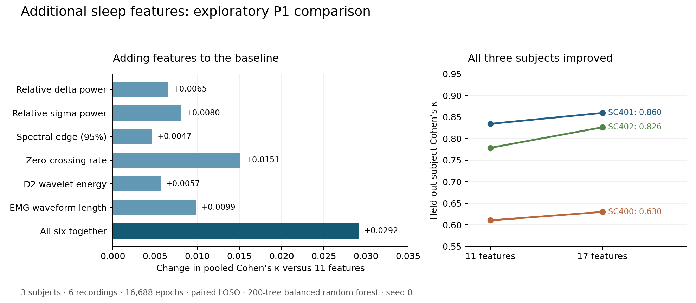

# Additional feature validation — 10 November 2026

Adding the six eligible experimental features improved pooled Cohen’s κ from **0.749785 to 0.778985** and macro-F1 from **0.650569 to 0.677536** in this three-subject pilot. All three held-out subjects improved. The production extractor still uses its original 11 features.



## What was tested

The vectorized `AdvancedSleepFeatures` prototype in `tests/test_features2.py` was checked using known synthetic signals and six real recordings: subjects 0, 1 and 2, both nights, 16,688 labelled 30-second epochs. All recordings used P1 EEG band-pass filtering (0.5–40 Hz, fourth-order zero-phase Butterworth); EOG and EMG were retained. No cropping, feature selection, tuning or holdout scoring was performed.

Each experiment used the same three subject-wise LOSO folds, a fresh 200-tree random forest with balanced class weights and seed 0, and a scaler fitted only on the training subjects. Both nights stayed in the same fold. All model variants used identical epoch labels and evaluation order. The rerun baseline reproduced every prediction from the archived Mac P1 run `real__P1_20261008T115727461008Z`.

## Numerical findings and corrections

- A fixed `1e-12` added to power denominators changed supposedly relative features when signal units changed. For a known mixture with true delta/sigma fractions 0.8/0.2, the original extractor returned 0.4444/0.1111 at a 1 µV scale. Its 13 Hz spectral edge became 0.5 Hz. Safe division now preserves scale invariance and handles zero power explicitly.
- A synthetic 20 Hz EMG tone at a 1 µV amplitude was incorrectly reported as 10 Hz for the same reason; it now returns 20 Hz.
- Strict adjacent-sample products missed crossings separated by exact zero samples. The corrected zero-crossing calculation carries the last nonzero sign through zero runs.
- Flat signals now return zero for spectral edge and median frequency, instead of spurious band-edge values. Empty batches retain their column count; non-finite inputs fail clearly.
- **EMG median frequency is excluded on these real recordings.** Reading the original EMG channel alone confirmed a native rate of **1 Hz in all six files**. The 100 Hz mixed-channel arrays are resampled envelopes and contain no measured 10–45 Hz EMG spectrum. The extractor now accepts the native rate and skips this feature accordingly. Its calculation passes the synthetic broadband-EMG check.
- EMG waveform length is retained only as a measure of variation in the resampled envelope. It must not be interpreted as a high-frequency EMG measurement.

All **12 new signal-based checks pass**, and all **62 project unittest checks pass**. Original failures are retained in [numerical_tests_before.txt](numerical_tests_before.txt) and [numerical_before.json](numerical_before.json); the final verification is in [verification.json](verification.json). The separate scalar helper in `tests/test_features.py` was not used in this experiment.

## Paired model comparisons

Δκ is the change in pooled Cohen’s κ relative to the rerun 11-feature baseline.

| Feature set | Columns | Pooled κ | Δκ | Macro-F1 | Balanced accuracy | Accuracy | Mean subject κ ± sample SD |
|---|---:|---:|---:|---:|---:|---:|---:|
| Baseline | 11 | 0.749785 | +0.000000 | 0.650569 | 0.615244 | 0.879075 | 0.741176 ± 0.116460 |
| Baseline + all six | 17 | 0.778985 | +0.029200 | 0.677536 | 0.635359 | 0.893576 | 0.772026 ± 0.123952 |
| Six additional features only | 6 | 0.628886 | -0.120899 | 0.607217 | 0.626979 | 0.798658 | 0.633291 ± 0.082460 |
| Baseline + Relative delta power | 12 | 0.756270 | +0.006484 | 0.663266 | 0.627459 | 0.881951 | 0.748231 ± 0.108037 |
| Baseline + Relative sigma power | 12 | 0.757817 | +0.008032 | 0.662346 | 0.627345 | 0.882490 | 0.749666 ± 0.111633 |
| Baseline + Spectral edge (95%) | 12 | 0.754459 | +0.004674 | 0.659722 | 0.625173 | 0.880872 | 0.746316 ± 0.111111 |
| Baseline + Zero-crossing rate | 12 | 0.764918 | +0.015133 | 0.669113 | 0.628262 | 0.886925 | 0.756692 ± 0.115678 |
| Baseline + D2 wavelet energy | 12 | 0.755456 | +0.005670 | 0.665134 | 0.630196 | 0.881232 | 0.747241 ± 0.112586 |
| Baseline + EMG waveform length | 12 | 0.759657 | +0.009871 | 0.659073 | 0.617802 | 0.884348 | 0.751692 ± 0.134249 |

Zero-crossing rate produced the largest pooled κ gain among single additions (+0.015133). All six single additions increased pooled κ in this run, but individual subject changes were not uniformly positive: adding EMG waveform length alone reduced SC400 κ, and adding wavelet energy alone slightly reduced SC402 κ. The six features alone were weaker than the original baseline on κ and macro-F1.

## Subject and stage detail

| Held-out subject | Epochs | Baseline κ | 17-feature κ | Paired Δκ |
|---|---:|---:|---:|---:|
| SC400 | 5479 | 0.610587 | 0.630191 | +0.019603 |
| SC401 | 5650 | 0.834272 | 0.859564 | +0.025291 |
| SC402 | 5559 | 0.778669 | 0.826323 | +0.047654 |

| Stage | Baseline recall | 17-feature recall |
|---|---:|---:|
| W | 97.42% | 98.66% |
| N1 | 22.99% | 23.66% |
| N2 | 90.62% | 91.69% |
| N3 | 38.63% | 44.53% |
| REM | 57.98% | 59.14% |

Every eligible feature was finite and nonconstant across all 16,688 epochs. Relative powers and wavelet-energy fractions were within [0, 1]. See [feature_statistics.csv](feature_statistics.csv) and [feature_by_stage.csv](feature_by_stage.csv) for ranges and stage summaries.

## Interpretation and limits

This is evidence that the six features are useful candidates when added to the existing set. Three development subjects and one seed do not establish a reliable improvement across the full 68-subject development cohort. Wake accounts for 11,340/16,688 epochs (68.0%); N1 recall remains low at 23.7% with 17 features. No confidence interval or significance claim is made. Adding columns also changes the random forest’s feature sampling, so single-addition results describe whole-model comparisons rather than isolated causal feature contributions. The production feature set was not changed.

## Reproduce and inspect

```bash
MPLCONFIGDIR=/private/tmp/sleepedf-feature-mpl .venv/bin/python -B -m unittest discover -s tests -v
MPLCONFIGDIR=/private/tmp/sleepedf-feature-mpl .venv/bin/python -B scripts/evaluate_additional_features.py \
  --subjects 0 1 2 --nights 1 2 --preprocess bandpass \
  --output-dir results/additional_features_new_run
```

Use a new output directory for each run. [provenance.json](provenance.json) records source and EDF hashes, versions, native EMG rates and model settings. [summary.csv](summary.csv) and [per_subject.csv](per_subject.csv) contain the precise scores. The nine `*_report.json` files contain aligned held-out predictions and confusion matrices; [feature_matrices.npz](feature_matrices.npz) contains both feature matrices, labels, subject IDs and recording IDs.
